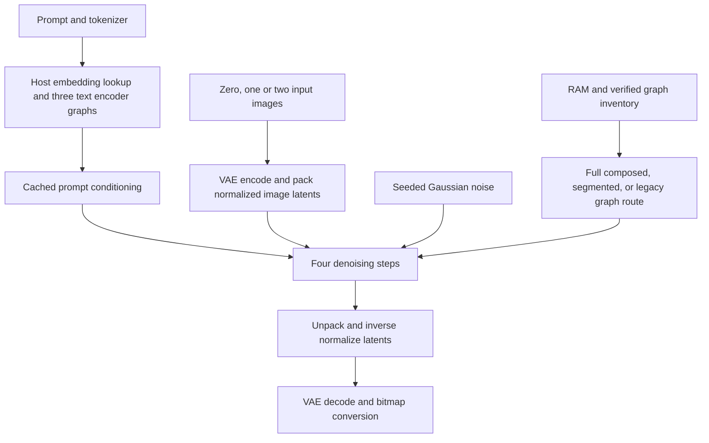

# Gestura 4.0.6: inference reverse-engineering report

## Findings

The distinctive part of Gestura is its orchestration of large models on a memory-constrained Android GPU: split and composed LiteRT graphs, weight and program caches, graph residency selection, tensor-buffer chaining, and explicit resource lifetime control. Image generation is a FLUX.2 Klein 4B pipeline. Video generation combines MiniMax H3/FastH3, a custom stable-diffusion.cpp/ggml Vulkan library, LiteRT execution paths, separate video/audio latent trajectories and VAE stages, and Android hardware encoding.

**The production image pipeline in this APK explicitly forces `GPU_ONLY`.** Bundled NPU graph transformers and strict NPU workers do not establish that image generation normally uses the NPU. The constructor logs that older execution-mode selections are ignored. Video contains both native Vulkan and plan-controlled LiteRT execution paths; selecting a particular path depends on installed artifacts and validated device-specific plans.

This is a static reverse-engineering result, with executable reconstructions of selected equations. It is not a recovered original repository or a demonstrated standalone replacement app.

## Inputs, method, and limits

Inputs came from `/sdcard/Download/TinyKit/Gestura-4.0.6/`: `base.apk`, `split_config.arm64_v8a.apk`, and the English and xxhdpi resource splits. `aapt` confirms package `com.zawshishawn.gestura`, version name `4.0.6`, version code `107`, min SDK 32 and target SDK 36. The two large APKs are about 101 MiB and 98 MiB; there was no need to upload them through chat.

Analysis includes ZIP inventories and SHA-256 hashes; Java-like decompilation of all three DEX files using JADX 1.5.3; a second raw-instruction fallback pass; ELF dynamic symbols, dependencies and strings; selected AArch64 disassembly; and extraction of model manifests and notices. The structured decompilation finished with 55 errors. Raw fallback completed successfully and preserves instruction-level evidence for methods that could not be reconstructed as Java.

Evidence levels used below:

- **Code:** explicit DEX behavior or an extracted manifest.
- **Native evidence:** exported symbols, disassembly or embedded diagnostic strings. A string alone proves that code or diagnostics were compiled in, not that a route executed.
- **Interpretation:** an explanation of the engineering purpose consistent with those observations.

No models were downloaded, no generation jobs were started, and no private app data or current runtime settings were extracted. Latency, image quality, thermal behavior and actual peak RAM are unmeasured. Large external TFLite/GGUF files and device-specific worker-plan data are not supplied by these APKs, so their full graph internals cannot be recovered from the APK alone.

## Image inference

### Model package and components

`tl1.java` identifies:

- Model directory: `flux2-klein-4b`.
- Converted artifact repository: `ZawShiShawn/gestura-flux2-klein-4b-litert-tflite`.
- Pinned converted revision: `bbe6ddc8de9daa338b150fa3b66c1ae52a5ae4c7`.
- Upstream model: `black-forest-labs/FLUX.2-klein-4B`.
- Pinned upstream revision: `e7b7dc27f91deacad38e78976d1f2b499d76a294`.
- Installed-package identifier: `local/gestura-flux2-static-multi-geometry`.

These are strings recovered from the APK, not independently verified live repository contents. The catalog pins filenames, sizes and hashes and includes a byte-range source for the host timestep/guidance embedding weights.

`gq1.java` defines three graph families:

| Family | Conditioning | Graph stages |
|---|---|---|
| `kc` | Text only | prep, two double-block graphs, four single-block graphs, final |
| `kce` | One image | corresponding editing graphs |
| `kce2` | Two images | native dual-image editing graphs |

Shared stages are `ke_enc0.tflite`, `ke_enc1.tflite`, `ke_enc2.tflite`, `kv_vae_enc.tflite` and `kv_vae.tflite`. The catalog names composed denoisers for 256x256, 512x512, 512x384, 480x320 and 512x288 with text capacity 512. Segmented composed versions use segments a/b/c, with a fourth segment d for the dual-image family. Catalog membership does not prove every artifact is installed or admitted on this phone.

Representative pinned sizes in `tl1.java` are 912,190,032 bytes for each text-encoder graph, 166,174,032 for text prep, roughly 492 MB for a double stage, roughly 615 MB for each single stage, 50,207,984 for the VAE decoder and 34,872,640 for the VAE encoder. These sizes explain why graph residency and shared weight storage matter.

### Reconstructed image data flow



The DEX exposes a 2560-wide text representation and 7680-wide prompt conditioning assembled from three text-stage results. Maximum text capacity is 512 tokens; transformer width is 3072. A separate host embedding file is named `qwen_embed_fp16.bin`.

Image preprocessing resizes/crops according to the selected fit mode, extracts RGB, normalizes each component as `value/127.5 - 1`, and sends channel-first tensors `[1,3,H,W]` to the VAE encoder. The returned 32-channel latent is packed in 2x2 spatial blocks into 128 channels, normalized using explicit per-channel mean/variance constants with epsilon `1e-4`, and transposed into token-major form. At 256x256, the constants describe a 32x32 VAE grid packed into a 16x16 grid of 128-channel tokens.

Image-to-image initialization mixes normalized encoded latents and noise as `(1-sigma)*encoded + sigma*noise`. Strength zero selects a reconstruction path; an edit image is required for strengths other than one. There are at most two conditioning images, and a second reference image requires the first editing image. Conditioning latents and prompt embeddings have separate caches.

After denoising, raw fallback instructions in `du1.java` show token/CHW conversion, inverse normalization, unpacking, finite-value checks, and VAE decoding. The structured Java version of that large coroutine failed; the raw fallback copy is included so this part is reviewable.

### Exact recovered image scheduler

`pp1.i` generates four base times `t[i] = (1-i/4)*strength`, then computes a token-dependent shift. Let `n` be the image-token count:

```
high = n*0.00016927 + 0.45666666
if n > 4300:
    mu = high
else:
    low = n*0.0000873809524 + 1.89833333
    slope = (high-low)/190
    mu = slope*4 + high - 200*slope
sigma[i] = exp(mu) / (1/t[i] - 1 + exp(mu))
delta[i] = sigma[i+1] - sigma[i]  # final next sigma is zero
x = x + velocity*delta[i]
```

The zero-strength case returns an empty schedule. `recovered/inference_math.py` implements this and other recovered operations. It intentionally does not claim bit-identical Android float32 rounding or Java Gaussian RNG compatibility.

### Memory and execution architecture

`fu1` forces GPU-only execution. `da4` chooses a route using the effective reported RAM value:

| Effective RAM value | Initial route |
|---|---|
| At least 10 GiB | `FULL_COMPOSED` |
| At least 6 GiB but below 10 GiB | `SEGMENTED_SINGLE_RESIDENT` |
| Below 6 GiB | `LEGACY` |

Those numeric thresholds correspond to named device classes in the source; they are not available-memory measurements. `m65` can adjust the effective reported value, and later admission/calibration can further restrict execution. Segmented routing defines a 5.5 GiB absolute PSS limit. The exact live route on the user's phone has not been measured.

`qf4` implements a GPU generation pool with several policies:

- Full composed denoising can retain one compiled model across four invocations and records zero *stage* readbacks on that route.
- Segmented composed execution limits live compiled models to one and has host transfers at segment boundaries.
- Legacy graph execution measures graph demand, selects safe resident subsets and treats other graphs as transient.
- Prompt-stage and denoiser-stage residency are coordinated rather than each stage owning an unrelated pool.
- Packed constants, execution-cache entries and GPU program caches have separate ownership and admission mechanisms.

The JNI bridge offers shared tensor arenas, packed-weight-cache bindings, geometry-selected signatures, execution leases, active-working-set leases and idle cache trimming. Native diagnostics attest requested accelerator masks and report CPU fallback disabled for certain selected-signature paths. This is stronger evidence than a UI label, but still requires runtime traces to prove a specific invocation used them.

**Interpretation:** keeping expensive compiled graphs and weights only when they fit, retaining GPU tensors between compatible stages, and reusing program/weight caches reduces repeated compilation, allocation and CPU/GPU copies. The implementation does not make every route zero-copy; the code explicitly has fallback arrays and host boundaries.

### NPU machinery versus the active image path

`libgestura_flux_npu_transform_jni.so` exposes `TransformFluxGraphForStrictNpu`. Its reports include transformed fully-connected-op counts, inserted casts, appended bytes, FlatBuffer verification, source/delta/patch hashes, segmentation profile and segment contracts. Native strings identify v3 segment and v4 head-tile profiles. `LiteRtStrictNpuCompiledModelBridge` exposes NPU-only mask 4 and NPU+GPU/no-CPU mask 6. There is also a separate worker service and cancellation protocol.

This is real bundled graph-conversion infrastructure. However, the main image pipeline explicitly selects GPU-only, and many similarly named bridge methods also serve GPU-selected signatures. The library name alone must not be interpreted as evidence of NPU acceleration in the normal image flow.

## Video and audio inference

### Models and conversion contracts

The main contract is `minimax-h3-v3.1-q4km-v22-vae-litert-fasth3-delta`.

Extracted manifests identify:

| Component | Artifact | Declared bytes |
|---|---|---:|
| FastH3 diffusion | `fasth3_dense_v1_euler4_Q4_K_M.gguf` | 11,583,540,608 |
| Qwen text/vision encoder | `Qwen3-VL-4B-Instruct-Q4_K_M.gguf` | 2,497,282,336 |
| Vision projector | `mmproj-F16.gguf` | 836,180,640 |
| ClipProj residual MLP | `mmh3-4b-ClipProj-v3.1-mlp.safetensors` | 503,423,800 |
| Audio VAE | `minimax_h3_audio_vae_fp32.safetensors` | 605,254,808 |
| GGUF video VAE manifest entry | `minimax_h3_video_vae_Q8_0.gguf` | 2,936,962,688 |

The current configuration builder sets the ordinary `video_vae` path empty and installs a LiteRT video-VAE package instead. Therefore the GGUF VAE entry should not be assumed to be the active decoder.

The dense diffusion manifest pins FastVideo's four-step preview conversion and a source revision. A separate Ref2VA delta manifest declares an approximately 4.24 GB delta data file and a 43,712-byte descriptor that reconstruct an approximately 11.39 GB target model against a hash-identified dense base. This is a storage/distribution technique; it does not make the inference model itself 43 KB.

### Generation paths and output geometry

`MiniMaxVideoService` serializes jobs on a worker, tracks cancellation, and orchestrates model release. `e56` builds the job directory/configuration and coordinates phases. `VideoNativeBridge.nativeRun(config,promptBytes,phase)` is the native entry point.

`c66` constructs a native configuration with `Vulkan0`, device identity, 124 frames, 24 fps, square output 256 or 384, video shift 12 and a seed. At 24 fps, 124 frames correspond to about 5.17 seconds. Mode constants are AUTO/T2VA/I2VA/REF2VA at four steps and FL2VA at eight steps. These constants do not prove all combinations pass route-specific validation; the explicit LiteRT trajectory discussed below is four-step.

The native video library contains stable-diffusion.cpp and ggml code. A build marker is `sd-d04e895-ggml-e20c3a14-gestura-cut-v40-vae-fusions`. Embedded source paths name MiniMax H3 diffusion, video VAE and audio VAE implementations. Native diagnostics describe fusion-group budgeting, deferred prefetch, actual-resource admission checks and mapped-page reclamation. Other model-family names in that shared native engine are not proof that Gestura exposes those models in its app.

### Plan-controlled LiteRT four-step trajectory

A distinct path marks the denoiser backend `LITERT_FULL_EXECUTION_MIXED`. It loads a `fasth3_litert_worker_plan` only after validating runtime and input identity, device identity, manifests, graph packages, chain identity, capacity evidence and backend requirements. Schemas include `gestura.video.full-batch-chain.v1` and `gestura.fasth3.backend-batch-plan.v1`.

The plan requires trajectory policy `RAW_H3_DX_DT_EULER4_V2`. It uses a specifically hash-identified `libLiteRtGpuAccelerator.so` runtime. This is not a generic promise that any installed LiteRT build can load the converted graphs.

`ai1` creates the LiteRT environment and a residency-managed graph provider; `nh1` executes graph chains and calls `kh1` to advance video/audio latents. Tensor chaining uses stage leases and a GPU completion barrier. `ai1` requires all GPU ownership to drain before closing the environment and starting the VAE. It checks that steps 0,1,2,3 completed, writes execution evidence and then exports final latent files.

Recovered schedules:

```
video = [1, 0.972972972972973, 0.9230769230769231, 0.8, 0]
audio = [1, 0.9, 0.75, 0.5, 0]
for step in 0..3:
    x_video += dx_video * (video[step] - video[step+1])
    x_audio += dx_audio * (audio[step] - audio[step+1])
```

This has the opposite delta sign to the image velocity update. Reference prefixes remain unchanged: 96 values per preserved video token and 32 per preserved audio token. Mixing these conventions when implementing a replacement would produce the wrong trajectory.

### VAE and encoding

Extracted decoder manifests define a prep graph, twelve three-block groups covering blocks 0 through 36, and a final graph: fourteen graph files in total. Weights are INT8 per channel. The 384 package explicitly declares 384x384 output, 24x24 latent spatial size, one spatial pass and source-backed storage.

The causal encoder manifest defines temporal variants 1, 5 and 17, with eighteen graph files per variant, `THWC` layout and `posterior_mean` output. These are explicit package contracts, not assumptions inferred from a generic VAE architecture.

After decoding, Android `MediaCodec` supplies a hardware AVC/H.264 encoder; audio uses AAC (`audio/mp4a-latm`), and `MediaMuxer` combines tracks into MP4. Native intermediates include RGB frames and PCM audio. The app checks codec size support and output timing/counts; diffusion inference and MP4 compression are separate stages.

## Text inference, as a secondary result

The APK has three runtime enum values: `LLAMA_CPP`, `LITERT_LM` and `GENIEX_QAIRT`. Artifact extensions map `.gguf`/`.mmproj`, `.litertlm` and `.qairt` to their runtimes.

The llama path selects architecture-specific JNI variants after CPU-feature checks and cached native probes, then uses shared llama/ggml dependencies. Its bridge exposes model initialization, Jinja/chat-template application, streaming text and multi-image sessions, token counts, persistent state, turn rewind and whole-turn trimming. Native symbols/logs reveal separate text-prefill, generation-thread, vision-stage, decode-batch and output-batch tuners.

Disassembly shows a sampler chain consisting of optional reasoning-budget handling, repetition penalties, top-k, top-p, optional min-p, temperature and distribution sampling. The default Java parameters are max output tokens 2048, temperature 0.8, top-k 40, top-p 0.9, min-p 0 and repetition penalty 1. User/model metadata may override these defaults.

LiteRT-LM tries GPU and CPU engine/vision combinations, maintains close/drain fences and inspects speculative-decoding capability while applying a disabled global speculative setting in the observed code. GenieX wraps Qualcomm text/vision generation and validates pinned artifact metadata. Neither is the main FLUX image pipeline.

## What is reusable now

The bundle contains:

- `recovered/inference_math.py`: executable FLUX scheduling, image initialization/packing and H3 video/audio updates.
- Five checks for schedule direction, reference-prefix preservation, packing layout, endpoints and input validation; all passed.
- Structured Java-like source for the key pipelines, model catalogs, memory policies and JNI bridges.
- Raw fallback instruction listings for the same core classes, including the otherwise missing image-generation coroutine.
- Original extracted model manifests and notices, file hashes, native export mapping and selected native evidence.

The reusable design is to separate host preprocessing, persistent conditioning, staged denoiser execution, GPU-cache ownership and final decoding, with a measured memory-admission policy rather than assuming all weights fit simultaneously.

A faithful runnable clone still needs the actual external graph packages, weights and matching runtime/plan files, followed by execution tests. Original variable names, all native C++ source, conversion tooling and measured device behavior have not been recovered. The raw fallback and disassembly support further analysis without presenting decompiler mistakes as app bugs.

## Local workspace

Full analysis remains in `/root/.buddy/work/gestura-research/`: original APK copies, `decompiled/`, `fallback/`, extracted `native/`, `assets-evidence/` and `evidence/`. The compact deliverable omits the APKs, native binaries and bulk third-party code to avoid another oversized attachment. `code/source-map.json` maps included obfuscated classes to their observed roles. All findings in this report derive from local artifacts, not current web claims.
